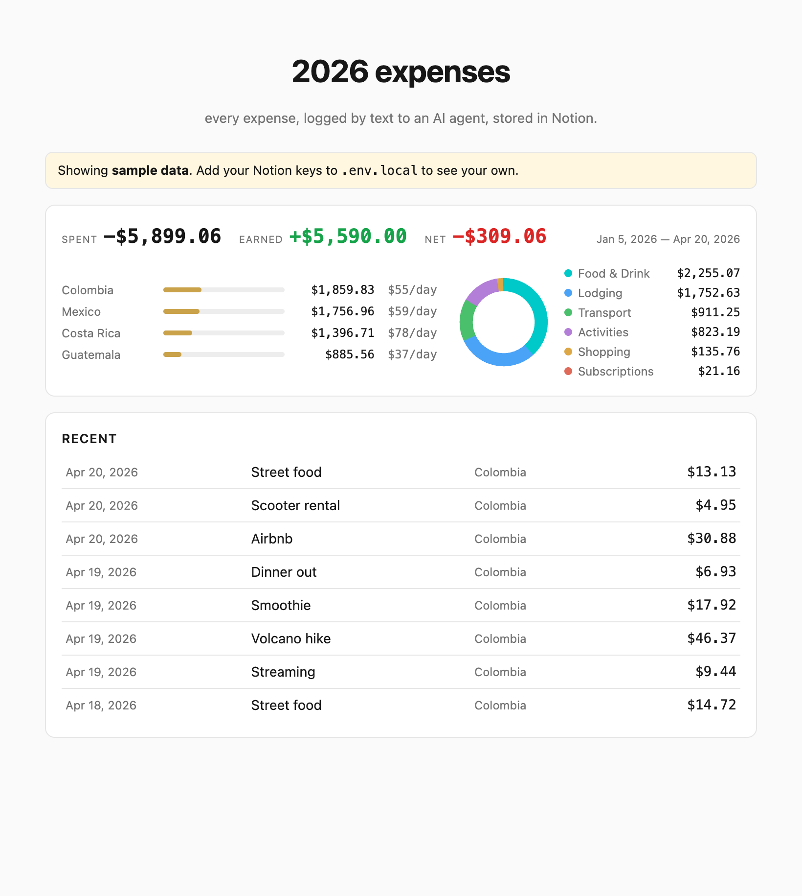

# data-tracking

A barebones starter for a simple way to track anything:

> **Text an AI agent → it writes a row to Notion → your site turns the rows into a dashboard.**

I used this to log every expense of a 2026 backpacking trip with almost no effort. I'd text "14.50 tacos" and it showed up on my site, sorted by category and country. This repo is that setup with the personal data taken out, so you (or your AI coding agent) can copy the method.

<picture>
  <source media="(prefers-color-scheme: dark)" srcset="docs/dashboard-dark.png">
  
</picture>

<sub>All numbers above are generated sample data.</sub>

---

## How it works

```
 you ──text──▶ AI agent (Poke) ──Notion integration──▶ Notion database
                                                            │
                                     NOTION_API_KEY (read)  │
                                                            ▼
              browser ◀── dashboard ◀── /api/data/expenses (Next.js route)
```

1. **Capture**: an AI agent with a Notion integration turns plain messages into database rows.
2. **Store**: Notion is the database. You can always open it and fix a row by hand.
3. **Serve**: one API route reads the database with a read-only key and returns clean JSON.
4. **Show**: a small dashboard renders that JSON. No chart library needed.

---

## Quick start (sample data, no setup)

```bash
pnpm install
```

```bash
pnpm dev
```

Open http://localhost:3000. With no Notion keys set, the app serves [`data/expenses.sample.json`](data/expenses.sample.json).

---

## Use your own data

### 1. Make the Notion database

Create a full-page database with these columns (names must match [`datasets.config.ts`](datasets.config.ts), or edit that file):

| Column         | Type        | Example        |
| -------------- | ----------- | -------------- |
| `Expense`      | Title       | Tacos          |
| `Amount (USD)` | Number      | 14.50          |
| `Earned`       | Number      | *(for income)* |
| `Date`         | Date        | 2026-03-02     |
| `Category`     | Select      | Food & Drink   |
| `Location`     | Select      | Mexico         |
| `Notes`        | Text        |                |

### 2. Capture: connect an AI agent

Any agent that can write to Notion works. I use [Poke](https://poke.com):

1. Sign up and connect the **Notion** integration.
2. Give it a standing instruction, for example:
   > When I send a price and an item, add a row to my Expenses database in Notion. Set Date to today, pick the closest Category, and set Location to the country I'm in.
3. Text it things like `14.50 tacos` or `got paid 1200 for the logo job`.

**This step alone is a working expense tracker.** The rest just makes it look good.

### 3. Serve: create a read-only Notion connection

1. Go to [notion.so/profile/integrations](https://www.notion.so/profile/integrations) → **New integration** (internal). Give it **Read content** only.
2. Copy the **Internal Integration Secret**. This is `NOTION_API_KEY`.
3. Open your database → `•••` → **Connections** → add your integration.

### 4. Find the IDs

This uses Notion's current API, which queries **data sources** (a database can hold several).
Open the database → `•••` → **Manage data sources** → `•••` next to the source → **Copy data source ID**.

### 5. Add env vars

```bash
cp .env.example .env.local
```

```
NOTION_API_KEY=ntn_...
NOTION_EXPENSES_DATA_SOURCE_ID=...
```

Restart `pnpm dev` and the sample-data banner disappears.

### 6. Deploy

Push to GitHub, import it on [Vercel](https://vercel.com/new), and add the same env vars. Responses are cached for 60 seconds, so new rows show up within about a minute.

---

## Track something else

Everything is driven by [`datasets.config.ts`](datasets.config.ts). Add an entry and you get `/api/data/<name>` for free:

```ts
habits: {
  dataSourceEnv: "NOTION_HABITS_DATA_SOURCE_ID",
  fields: { title: "Name", date: "Date", done: "Done", minutes: "Minutes" },
  sortBy: "Date",
  sample: "habits.sample.json",
},
```

Then build a component that fetches it. See [AGENTS.md](AGENTS.md). You can hand that file straight to an AI coding agent.

---

## Files

```
datasets.config.ts                  ← which Notion DBs exist + column mapping
lib/notion.ts                       ← reads Notion (paginated) or falls back to sample JSON
app/api/data/[dataset]/route.ts     ← GET /api/data/<key> → { rows, source }
components/expenses-dashboard.tsx   ← the example dashboard
components/donut.tsx                ← dependency-free SVG donut
data/*.sample.json                  ← fake data (regenerate: pnpm sample)
```

## License

MIT
